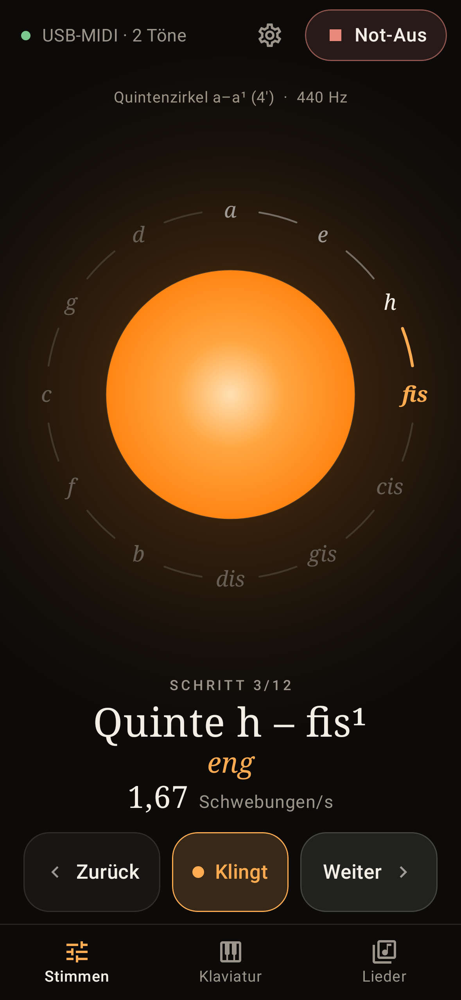
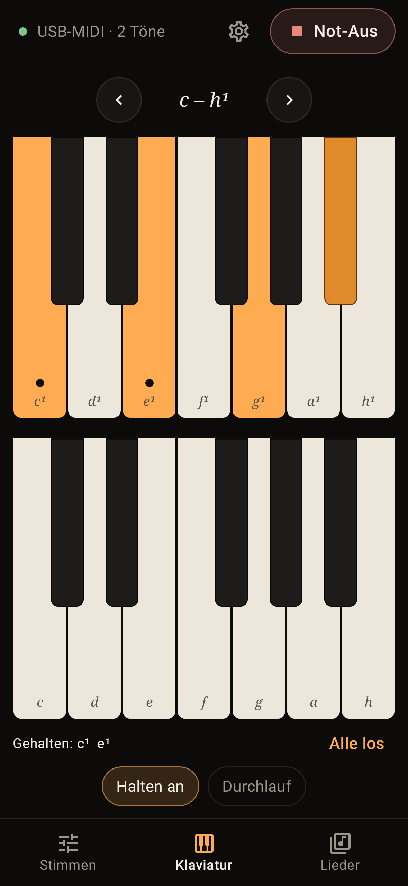
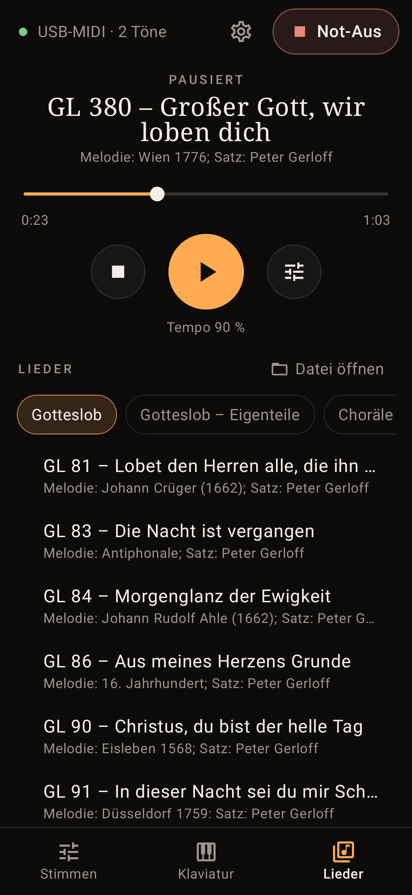
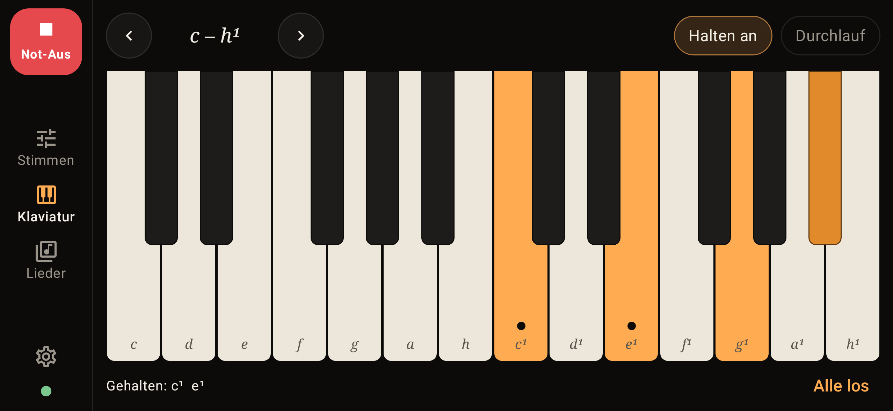

# Tastenhalter – MIDI-Steuerung für Orgel-Selbstspieleinrichtungen

Android-App zum Ansteuern einer Orgel über einen MIDI-Decoder, der Note-On/Note-Off in Magnetausgänge umsetzt –
zum Legen der Temperatur nach Gehör, zum Testen der Magnete und zum Abspielen von Liedern.

Kotlin · Jetpack Compose · Android 10+ · nur `android.media.midi`, keine Google-Play-Dienste nötig.

<p>
  
  
  
</p>
<p></p>

## Download

Die fertige APK liegt unter [Releases](../../releases). Auf dem Handy herunterladen, öffnen und die Installation
aus dieser Quelle erlauben.

## Aufbau

Drei Seiten (unten bzw. im Querformat links), oben immer der rote **Not-Aus**. Alle Einstellungen liegen im
Einstellungsmenü (Zahnrad).

- **Stimmen** – Temperatur legen wie in [Stimmlicht](https://github.com/casualistcode/stimmlicht): In der Mitte
  eines Quintenzirkels pulsiert ein Licht im Takt der Schwebung des aktuellen Intervalls – orange bei engen,
  blau bei weiten Intervallen, ruhig bei reinen. *Halten* lässt die Orgel das Intervall selbst spielen;
  beim Weiterschalten wechselt sie mit. Proben antippen: Licht und Orgel folgen der Probe.
  Stimmzirkel: Quintenzirkel a–a¹ (4′), Steinway e–e¹, Vallotti, Neidhardt „Dorf“ 1732,
  „Kleine Stadt“ 1732, „Große Stadt“ 1724. Rechnung und Stimmfolgen wie in Stimmlicht.
- **Klaviatur** – über den ganzen Umfang, im Hoch- und Querformat. *Halten* rastet Töne ein (z. B. einen
  Bezugston), *Durchlauf* spielt alle Töne nacheinander zum Prüfen der Magnete.
- **Lieder** – 315 Lieder aus dem Gotteslob (Stammteil und Diözesan-Eigenteile) und 57 weitere Choräle,
  Kirchenlieder, Advents- und Weihnachtslieder und Choralvorspiele, oder eine eigene .mid-Datei (auch „Öffnen mit“ aus dem Dateimanager). Tempo, Transponieren und Spuren über
  die Lied-Optionen.

**Einstellungen:** Verbindung (USB-MIDI per OTG, Bluetooth LE MIDI, automatisches Verbinden, Prüfton),
Stimmzirkel und Kammerton, sichtbare Tasten und Durchlauf, Orgel (tiefster/höchster Ton, gleichzeitige Töne,
MIDI-Kanal; Voreinstellung C–g³ = MIDI 36–91, 15 Töne, Kanal 1).

**Not-Aus:** Note Off für alle Töne des Umfangs (+ „All Notes Off“), nach 300 ms wiederholt. Wird außerdem
ausgelöst bei Stopp, Liedende, Trennen, Verbindungsverlust, jedem (Wieder-)Verbinden, Ändern der
Orgel-Einstellungen und beim Verlassen der App. Der Bildschirm bleibt an beim Stimmen, während ein Lied oder
Durchlauf läuft und solange ein Ton klingt.

Die Oberfläche ist auf Deutsch, Tonnamen wie im Orgelbau (C, c, c¹, c² …; b = Ton zwischen a und h).

## Mitgelieferte Lieder

Die Sätze stammen aus dem [Mutopia Project](https://www.mutopiaproject.org) und von
[Wikimedia Commons](https://commons.wikimedia.org) (vor allem Sätze von Peter Gerloff / Rabanus Flavus).
Die Melodien sind alt genug, um selbst gemeinfrei zu sein. Die Sätze und Tondateien sind gemeinfrei (Public
Domain) oder unter CC0 freigegeben – bis auf einige Gotteslob-Sätze von Peter Gerloff, die unter
[CC BY 3.0](https://creativecommons.org/licenses/by/3.0/) bzw.
[CC BY-SA 3.0](https://creativecommons.org/licenses/by-sa/3.0/) stehen (unverändert mitgeliefert; Urheber:
Peter Gerloff / Rabanus Flavus, Quelle jeweils in `lieder.tsv`). Die Dateien liegen unter [`app/src/main/assets/lieder`](app/src/main/assets/lieder),
die Liste mit Quellen steht in [`lieder.tsv`](app/src/main/assets/lieder/lieder.tsv).

**Gotteslob**

315 Lieder nach den Nummern des Gotteslob 2013: 200 aus dem Stammteil (Gruppe „Gotteslob“) und 115 aus den
Eigenteilen Hamburg/Hildesheim/Osnabrück, Freiburg/Rottenburg-Stuttgart, Essen, Limburg, München-Freising,
Münster, Paderborn, Regensburg und Österreich (Gruppe „Gotteslob – Eigenteile“). Alle Sätze und Tondateien
stammen von Peter Gerloff (Rabanus Flavus) auf Wikimedia Commons – 282 CC0 oder gemeinfrei, 33 CC BY 3.0
bzw. CC BY-SA 3.0. Quelle, Lizenz und Melodie stehen bei jedem Lied in `lieder.tsv`. Wo mehrere Nummern
dieselbe Melodie haben, spielt die App für alle dieselbe Datei; der Titel ist der des Liedes, nach dem die
Datei benannt ist.

Nicht dabei sind Lieder, deren Melodie noch urheberrechtlich geschützt ist oder deren Herkunft unklar ist
(GL 188, 210, 360, 425, 464, 479, 483, 537, 548, 552). Jüngere Gotteslob-Lieder gibt es ohnehin nicht als
freie Dateien.

**Choräle & Kirchenlieder**

| Lied | Komponist / Melodie | Lizenz |
|---|---|---|
| [Lobe den Herren](https://www.mutopiaproject.org/ftp/Anonymous/lobe_den_Herren/lobe_den_Herren.mid) | Melodie: Stralsund 1665, Satz anonym | Public Domain |
| [Ein feste Burg ist unser Gott](https://www.mutopiaproject.org/ftp/LutherM/ein_feste_burg/ein_feste_burg.mid) | Martin Luther | Public Domain |
| [Jesus, meine Zuversicht](https://www.mutopiaproject.org/ftp/CrugerJ/Jesus_meine_zuversicht/Jesus_meine_zuversicht.mid) | Johann Crüger | Public Domain |
| [Mit Freuden zart](https://www.mutopiaproject.org/ftp/Anonymous/mit_freuden_zart/mit_freuden_zart.mid) | Melodie: Böhmische Brüder 1566, Satz anonym | Public Domain |
| [Allein Gott in der Höh sei Ehr (aus „Paulus“)](https://www.mutopiaproject.org/ftp/Mendelssohn-BartholdyF/O36/paulus_3/paulus_3.mid) | Felix Mendelssohn Bartholdy | Public Domain |
| [O Haupt voll Blut und Wunden (Matthäus-Passion)](https://www.mutopiaproject.org/ftp/BachJS/O_Haupt_voll_Blut/O_Haupt_voll_Blut.mid) | Johann Sebastian Bach | Public Domain |
| [Aus meines Herzens Grunde (BWV 269)](https://www.mutopiaproject.org/ftp/BachJS/BWV269/bwv_269/bwv_269.mid) | Johann Sebastian Bach | Public Domain |
| [Ich dank dir, lieber Herre (BWV 347)](https://www.mutopiaproject.org/ftp/BachJS/BWV347/bwv347/bwv347.mid) | Johann Sebastian Bach | Public Domain |
| [Gott, wie groß ist deine Güte (BWV 462)](https://www.mutopiaproject.org/ftp/BachJS/BWV462/bwv_462/bwv_462.mid) | Johann Sebastian Bach | Public Domain |
| [Ermuntre dich, mein schwacher Geist (BWV 454)](https://www.mutopiaproject.org/ftp/BachJS/BWV454/bwv_454/bwv_454.mid) | Johann Sebastian Bach | Public Domain |
| [Wie schön leuchtet der Morgenstern](https://www.mutopiaproject.org/ftp/NicolaiP/wie_schon_leuchtet/wie_schon_leuchtet.mid) | Philipp Nicolai | Public Domain |
| [Valet will ich dir geben](https://www.mutopiaproject.org/ftp/TeschnerM/st_theodulph/st_theodulph.mid) | Melchior Teschner | Public Domain |
| [Wer nur den lieben Gott läßt walten](https://www.mutopiaproject.org/ftp/NeumarkG/bremen/bremen.mid) | Georg Neumark | Public Domain |
| [Schönster Herr Jesu](https://www.mutopiaproject.org/ftp/Traditional/crusaders_hymn/crusaders_hymn.mid) | Melodie: Schlesien, traditionell | Public Domain |
| [Der Mond ist aufgegangen](https://www.mutopiaproject.org/ftp/SchulzJAP/mond/mond.mid) | Johann Abraham Peter Schulz | Public Domain |
| [Ich ruf zu dir, Herr Jesu Christ](https://www.mutopiaproject.org/ftp/Anonymous/Ich_ruf/Ich_ruf.mid) | anonym | Public Domain |

**Advent**

| Lied | Komponist / Melodie | Lizenz |
|---|---|---|
| [O komm, o komm, Immanuel (Veni Emmanuel)](https://www.mutopiaproject.org/ftp/Traditional/veniemma/veniemma.mid) | traditionell | Public Domain |
| [Macht hoch die Tür](https://commons.wikimedia.org/wiki/File:Macht_hoch_die_T%C3%BCr,_die_Tor_macht_weit.mid) | Melodie: Halle 1704 | Public Domain – Satz: Peter Gerloff (Rabanus Flavus) |
| [Tochter Zion, freue dich](https://commons.wikimedia.org/wiki/File:Tochter_Zion,_freue_dich.mid) | Georg Friedrich Händel | Public Domain – Tondatei: Peter Gerloff (Rabanus Flavus) |
| [O Heiland, reiß die Himmel auf](https://commons.wikimedia.org/wiki/File:O_Heiland,_rei%C3%9F_die_Himmel_auf.mid) | Melodie: Augsburg 1666 | CC0 – Satz: Peter Gerloff (Rabanus Flavus) |
| [Wie soll ich dich empfangen](https://commons.wikimedia.org/wiki/File:Wie_soll_ich_dich_empfangen.mid) | Johann Crüger 1653 | CC0 – Satz: Peter Gerloff (Rabanus Flavus) |
| [Maria durch ein Dornwald ging](https://commons.wikimedia.org/wiki/File:Maria_durch_ein_Dornwald_ging.mid) | Melodie: traditionell | CC0 – Satz: Peter Gerloff (Rabanus Flavus) |
| [Freut euch im Herrn, denn er ist nah](https://commons.wikimedia.org/wiki/File:Freut_euch_im_Herrn,_denn_er_ist_nah.mid) | Melodie: 1625/1836 | CC0 – Satz: Peter Gerloff (Rabanus Flavus) |

**Weihnachten**

| Lied | Komponist / Melodie | Lizenz |
|---|---|---|
| [Lobt Gott, ihr Christen allzugleich](https://www.mutopiaproject.org/ftp/Anonymous/Lobt_Gott/Lobt_Gott.mid) | Nikolaus Herman, Satz anonym | Public Domain |
| [Vom Himmel hoch, da komm ich her](https://www.mutopiaproject.org/ftp/Anonymous/von_himmel_hoch/von_himmel_hoch.mid) | Melodie: Leipzig 1539, Satz anonym | Public Domain |
| [Es ist ein Ros entsprungen](https://www.mutopiaproject.org/ftp/Anonymous/es_ist_ein_ros_entsprungen/es_ist_ein_ros_entsprungen.mid) | Melodie: Köln 1599, Satz anonym | Public Domain |
| [Stille Nacht, heilige Nacht](https://www.mutopiaproject.org/ftp/GruberFX/stille_nacht/stille_nacht.mid) | Franz Xaver Gruber | Public Domain |
| [Herbei, o ihr Gläub'gen (Adeste fideles)](https://www.mutopiaproject.org/ftp/WadeJF/adeste_fideles/adeste_fideles.mid) | John Francis Wade | Public Domain |

**Choralvorspiele für Orgel**

| Lied | Komponist / Melodie | Lizenz |
|---|---|---|
| [Großer Gott, wir loben dich (op. 135a Nr. 10)](https://www.mutopiaproject.org/ftp/RegerM/O135a/reger_grosser_gott_wir_loben_dich/reger_grosser_gott_wir_loben_dich.mid) | Max Reger | Public Domain |
| [Jesu, meine Freude (Orgelbüchlein, BWV 610)](https://www.mutopiaproject.org/ftp/BachJS/BWV610/bwv610/bwv610.mid) | Johann Sebastian Bach | Public Domain |
| [Vom Himmel hoch (Orgelbüchlein, BWV 606)](https://www.mutopiaproject.org/ftp/BachJS/BWV606/bwv606/bwv606.mid) | Johann Sebastian Bach | Public Domain |
| [Nun komm, der Heiden Heiland (BWV 599)](https://www.mutopiaproject.org/ftp/BachJS/BWV599/bwv599/bwv599.mid) | Johann Sebastian Bach | Public Domain |
| [Gelobet seist du, Jesu Christ (BWV 604)](https://www.mutopiaproject.org/ftp/BachJS/BWV604/bwv604/bwv604.mid) | Johann Sebastian Bach | Public Domain |
| [Der Tag, der ist so freudenreich (BWV 605)](https://www.mutopiaproject.org/ftp/BachJS/BWV605/bwv605/bwv605.mid) | Johann Sebastian Bach | Public Domain |
| [O Lamm Gottes, unschuldig (BWV 618)](https://www.mutopiaproject.org/ftp/BachJS/BWV618/bwv618/bwv618.mid) | Johann Sebastian Bach | Public Domain |
| [O Mensch, bewein dein Sünde groß (BWV 622)](https://www.mutopiaproject.org/ftp/BachJS/BWV622/OMenschMut/OMenschMut.mid) | Johann Sebastian Bach | Public Domain |
| [Vater unser im Himmelreich (BWV 636)](https://www.mutopiaproject.org/ftp/BachJS/BWV636/bwv636/bwv636.mid) | Johann Sebastian Bach | Public Domain |
| [Alle Menschen müssen sterben (BWV 643)](https://www.mutopiaproject.org/ftp/BachJS/BWV643/bwv643/bwv643.mid) | Johann Sebastian Bach | Public Domain |
| [Herzlich tut mich verlangen (BWV 727)](https://www.mutopiaproject.org/ftp/BachJS/BWV727/bwv727/bwv727.mid) | Johann Sebastian Bach | Public Domain |
| [In dulci jubilo (BWV 751)](https://www.mutopiaproject.org/ftp/BachJS/BWV751/bwv751/bwv751.mid) | Johann Sebastian Bach | Public Domain |
| [Ach bleib bei uns, Herr Jesu Christ (BWV 649)](https://www.mutopiaproject.org/ftp/BachJS/BWV649/bwv649/bwv649.mid) | Johann Sebastian Bach | Public Domain |
| [Erhalt uns, Herr, bei deinem Wort (BuxWV 185)](https://www.mutopiaproject.org/ftp/BuxtehudeD/Wv185/BuxWv185/BuxWv185.mid) | Dieterich Buxtehude | Public Domain |
| [Nun bitten wir den Heiligen Geist (BuxWV 208)](https://www.mutopiaproject.org/ftp/BuxtehudeD/Wv208/buxtehude_Wv208_nun_bitten_wir/buxtehude_Wv208_nun_bitten_wir.mid) | Dieterich Buxtehude | Public Domain |

**International (Hymnen & Carols)**

| Lied | Komponist / Melodie | Lizenz |
|---|---|---|
| [Freue dich, Welt (Joy to the World)](https://www.mutopiaproject.org/ftp/HandelGF/antioch/antioch.mid) | nach Georg Friedrich Händel | Public Domain |
| [Hark! The Herald Angels Sing](https://www.mutopiaproject.org/ftp/Mendelssohn-BartholdyF/mendelssohn/mendelssohn.mid) | Felix Mendelssohn Bartholdy | Public Domain |
| [The First Noel](https://www.mutopiaproject.org/ftp/Traditional/first_noel/first_noel.mid) | traditionell | Public Domain |
| [O Little Town of Bethlehem](https://www.mutopiaproject.org/ftp/RednerLH/st_louis/st_louis.mid) | Lewis H. Redner | Public Domain |
| [In the Bleak Midwinter](https://www.mutopiaproject.org/ftp/HolstGT/cranham/cranham.mid) | Gustav Holst | Public Domain |
| [Minuit, chrétiens (O Holy Night)](https://www.mutopiaproject.org/ftp/AdamA/minuit_chretiens/minuit_chretiens.mid) | Adolphe Adam | Public Domain |
| [Amazing Grace (New Britain)](https://www.mutopiaproject.org/ftp/Anonymous/new_britain/new_britain.mid) | traditionell | Public Domain |
| [Holy, Holy, Holy (Nicaea)](https://www.mutopiaproject.org/ftp/DykesJB/nicaea/nicaea.mid) | John Bacchus Dykes | Public Domain |
| [Ode an die Freude](https://www.mutopiaproject.org/ftp/BeethovenLv/ode/ode.mid) | Ludwig van Beethoven | Public Domain |
| [Nearer, My God, to Thee](https://www.mutopiaproject.org/ftp/MasonL/nmgtt/nmgtt.mid) | Lowell Mason | Public Domain |
| [Abide with Me (Eventide)](https://www.mutopiaproject.org/ftp/MonkWH/eventide/eventide.mid) | William Henry Monk | Public Domain |
| [O God, Our Help in Ages Past (St. Anne)](https://www.mutopiaproject.org/ftp/CroftW/st_anne/st_anne.mid) | William Croft | Public Domain |
| [Cwm Rhondda (Guide Me, O Thou Great Redeemer)](https://www.mutopiaproject.org/ftp/HughesJ/CwmRhondda/CwmRhondda.mid) | John Hughes | Public Domain |
| [Old Hundredth (Genfer Psalter)](https://www.mutopiaproject.org/ftp/BourgeoisL/Old100/Old100.mid) | Louis Bourgeois | Public Domain |

Weitere Lieder: `.mid`-Datei in den Ordner legen und eine Zeile in `lieder.tsv` ergänzen – nur Dateien mit
freier Lizenz.

## Bauen

Benötigt JDK 17 und das Android-SDK (Platform 35).

```
gradlew assembleRelease
adb install -r app/build/outputs/apk/release/app-release.apk
```

Die Release-APK wird mit dem lokalen Debug-Schlüssel signiert, damit sie sich direkt installieren lässt.

Bildschirmfotos aller Seiten (hoch und quer) ohne Handy: `gradlew testDebugUnitTest --tests de.tastenhalter.ScreenshotTest`
→ `app/build/screenshots/`.

## Sicherheit

Die App schaltet bei jedem Stopp, Verbindungswechsel und beim Verlassen alle Töne ab. Bei einer Funkstrecke
können trotzdem einzelne MIDI-Befehle verloren gehen – vor dem Einsatz an der Orgel Prüfton und NOT-AUS testen.
Benutzung auf eigene Verantwortung.

## Lizenz

Code: [MIT](LICENSE). Die mitgelieferten MIDI-Dateien sind gemeinfrei bzw. CC0, einige Gotteslob-Sätze von
Peter Gerloff CC BY 3.0 bzw. CC BY-SA 3.0 – jeweils angegeben in
[`lieder.tsv`](app/src/main/assets/lieder/lieder.tsv). Die MIT-Lizenz gilt für diese Dateien nicht.
